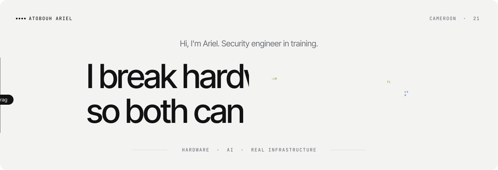
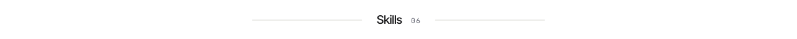
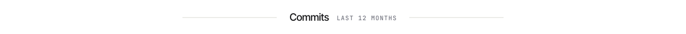

<picture>
  <source media="(prefers-color-scheme: dark)" srcset="assets/header-dark.svg">
  
</picture>

 

I'm a cybersecurity engineering student from Cameroon. I love hardware, AI and securing real infrastructure: 
I take systems apart to see what they assume about each other, then write down how to fix them.

  <a href="https://www.linkedin.com/in/atobouh-ariel">LinkedIn</a> &nbsp;·&nbsp;
  <a href="https://x.com/DevKuns43926">X</a> &nbsp;·&nbsp;
  <a href="mailto:arielatobs@gmail.com">arielatobs@gmail.com</a>

 

<picture>
  <source media="(prefers-color-scheme: dark)" srcset="assets/label-skills-dark.svg">
  
</picture>
<picture>
  <source media="(prefers-color-scheme: dark)" srcset="assets/skills-dark.svg">
  
</picture>

 

<picture>
  <source media="(prefers-color-scheme: dark)" srcset="assets/label-commits-dark.svg">
  
</picture>
<picture>
  <source media="(prefers-color-scheme: dark)" srcset="assets/commits-dark.svg">
  
</picture>

 

<picture>
  <source media="(prefers-color-scheme: dark)" srcset="assets/status-dark.svg">
  
</picture>

 

<a href="https://atobs.me">
<picture>
  <source media="(prefers-color-scheme: dark)" srcset="assets/door-dark.svg">
  
</picture>
</a>

Built slowly, learned honestly.

